<p align="center">
  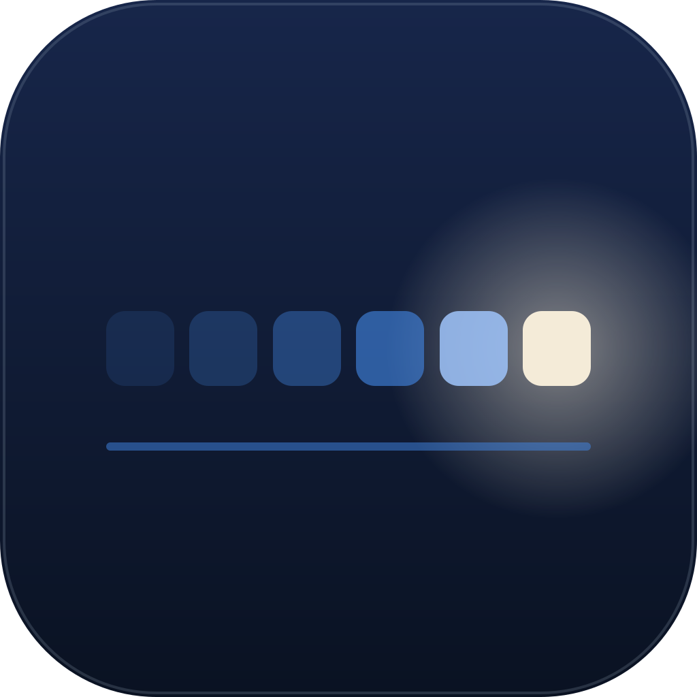
</p>

# Light Runner

[](LICENSE)

Light Runner lets volunteers run the lights for a church service from a tablet, after a five-minute briefing. They tap the next song in the running order and the whole room fades smoothly to it. One small server on a computer at the church drives the lights; every iPad, phone, Stream Deck and MIDI controller shows the same live state.

It was built for one church's stage and is shared under the MIT license so other churches and small venues can use it too.

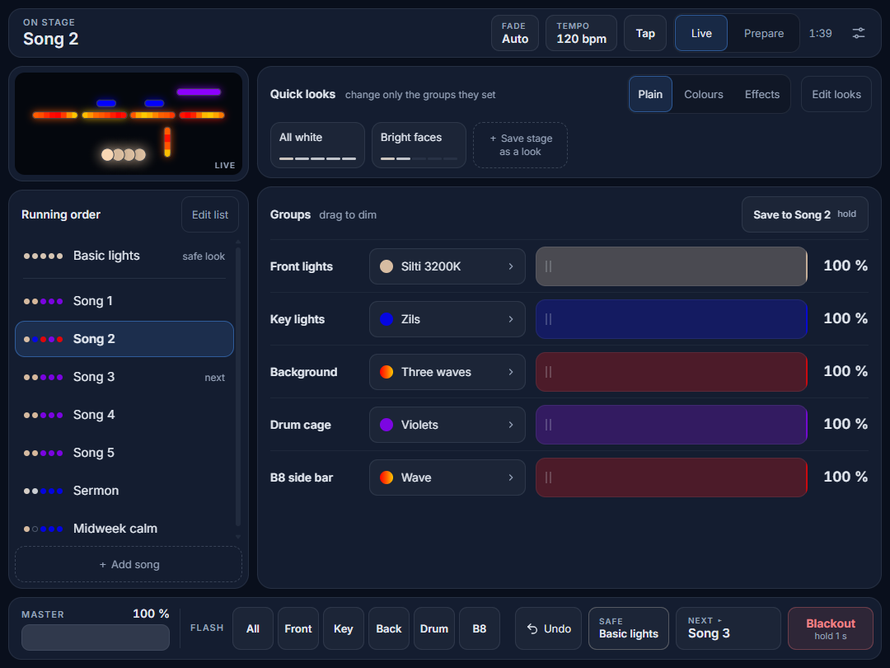

## Install

Download from the [latest release](https://github.com/ilmars/LightRunner/releases/latest). Nothing else needs installing first.

| System | Download | Notes |
| --- | --- | --- |
| Mac, Apple Silicon (M1 and newer) | `Light-Runner-<version>-arm64.dmg` | Open it and drag Light Runner into Applications. |
| Mac, Intel | `Light-Runner-<version>-x64.dmg` | The same. |
| Windows | `Light-Runner-Setup-<version>.exe` | Run it. It installs straight away, for you only, and asks nothing. |
| Raspberry Pi (64-bit Raspberry Pi OS) | the command below | No screen needed. Run the command again to update. |

```bash
curl -fsSL https://github.com/ilmars/LightRunner/releases/latest/download/install-pi.sh | sudo bash
```

The Pi starts Light Runner when it starts, and the command prints the address to open on the iPad. To read its log: `journalctl -u light-runner -f`.

**The first time you open it,** the Mac and Windows ask, because the downloads aren't signed yet. On a Mac, right-click (or Control-click) Light Runner, choose **Open**, then **Open** again. On Windows, when SmartScreen says it protected your PC, choose **More info**, then **Run anyway**. You only do this once.

**What you see.** On a Mac or Windows computer a small window shows whether Light Runner is running, with buttons to open the operator page and Settings. **Add an iPad or phone** shows the address in big letters with a code to point the camera at. Closing the window leaves Light Runner running in the menu bar (Mac) or the system tray (Windows); Quit is there, and asks first. Under **Options** you can change the port, choose whether Light Runner starts when the computer starts (it does, to begin with), and switch on **Test mode: don't send to the lights**, which is the way to try it away from the church. On Windows the window also says if the network is set to Public, which stops the iPads from reaching Light Runner, and shows how to make it Private.

A fresh install starts with a small demo rig that isn't connected to any lights, so nothing reaches your lights until you open your own show or choose an output in Settings. When a newer version is out, the window says "Version X is available" with a link. Updating is installing the new version over the old one (on the Pi, running the command again); the show stays.

**Where the show lives.**

| System | Folder |
| --- | --- |
| Mac | `~/Library/Application Support/Light Runner` |
| Windows | `%APPDATA%\Light Runner` |
| Raspberry Pi | `/var/lib/light-runner` |

**Moving a show in** (for example the church's, from a computer that runs Light Runner from source): on the old one, Settings > **Export show file**. On the new one, first make sure Lightkey isn't sending to the node (or switch **Send DMX** off in Settings), then Settings > **Open a show file…**, choose that file and confirm. The whole show is replaced, and the old one is kept as a backup in Settings > Backups. The file's node address comes with it; **Send DMX** and the programmer PIN stay as they are on this computer. When Lightkey isn't sending, switch Send DMX on. To take only some parts of a show (a few songs, or the fixtures from a Lightkey project) use **Compare with a file…** instead. The installed app doesn't read the old computer's `data/` folder by itself.

## A short tour

### Live, Prepare and Go

The operator page is made for an iPad held sideways. On the left are a small picture of the stage, drawn from what the lights are really doing, and the **running order**: Basic lights first (the safe look), then the songs. Tap a song and the stage fades to it; **Next ▸** in the bottom bar starts the one after it. On the right are **quick looks**, which change only some groups (say, the back wall to turquoise) and leave the rest alone, and **Groups**, with a colour button and a dimmer for each group of lights.

The bottom bar is always there: Master, Flash (while held), Undo, **Safe · Basic lights**, Next and Blackout (hold for a second). Fade sets how long changes take (each song's own, or Instant up to 10 s), and Tempo and Tap set the speed of effects.

**Prepare** gets the next moment ready without touching the lights. The top bar turns violet, and everything you change goes into a draft: pick a song, change colours, effects and levels, and watch the draft in the stage view. **Go ▸** sends the whole draft to the lights in one smooth change. Holding **Save to Sermon** (the button names the song) keeps the draft in that song for next time, still without touching the lights.

<p align="center">
  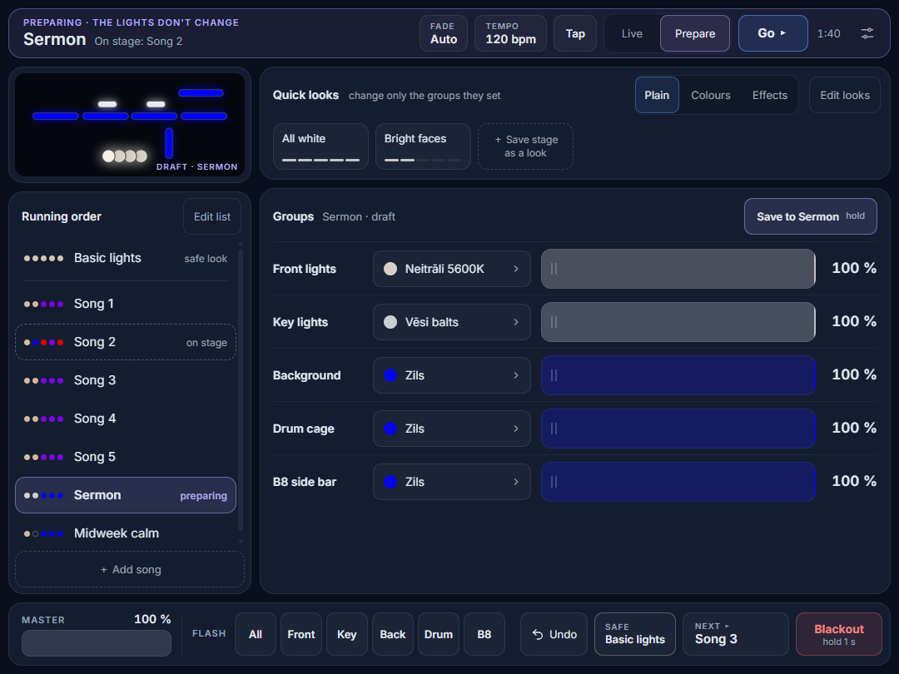
  <br>
  <em>Prepare: the Sermon is ready in the draft while Song 2 stays on stage. Go ▸ sends it.</em>
</p>

### Colours and effects

Tap a group's colour to open the **colour picker**. Tap a colour to fade the group to it, or drag along **Any colour** to try one live, paler or stronger with **Saturation**. Groups that have White, Amber or UV get a slider for each. **Hold** a colour (half a second) to edit it without changing the stage: rename it, change its colour, brightness and fade, and choose whether the change is for this group only or every group with that colour. **Exact values** takes a hex code or R, G and B.

The **Effects** tab has moving looks for any line of lights: colour fade, wave, chase, sparkle, breathe, meteor, fill and yo-yo. Hold one, or tap **All settings ›** on the running one, to open the effect editor: its colours and the order they play in, a base colour under it, speed in beats, direction and size. The strip at the top shows the effect moving on that group's lights; the stage doesn't change until Save.

<table>
  <tr>
    <td width="50%">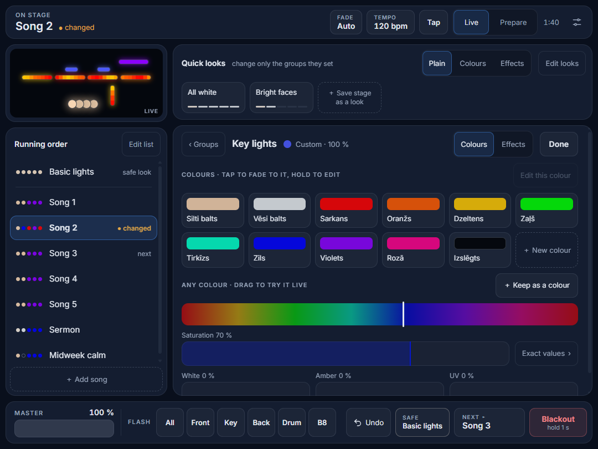</td>
    <td width="50%">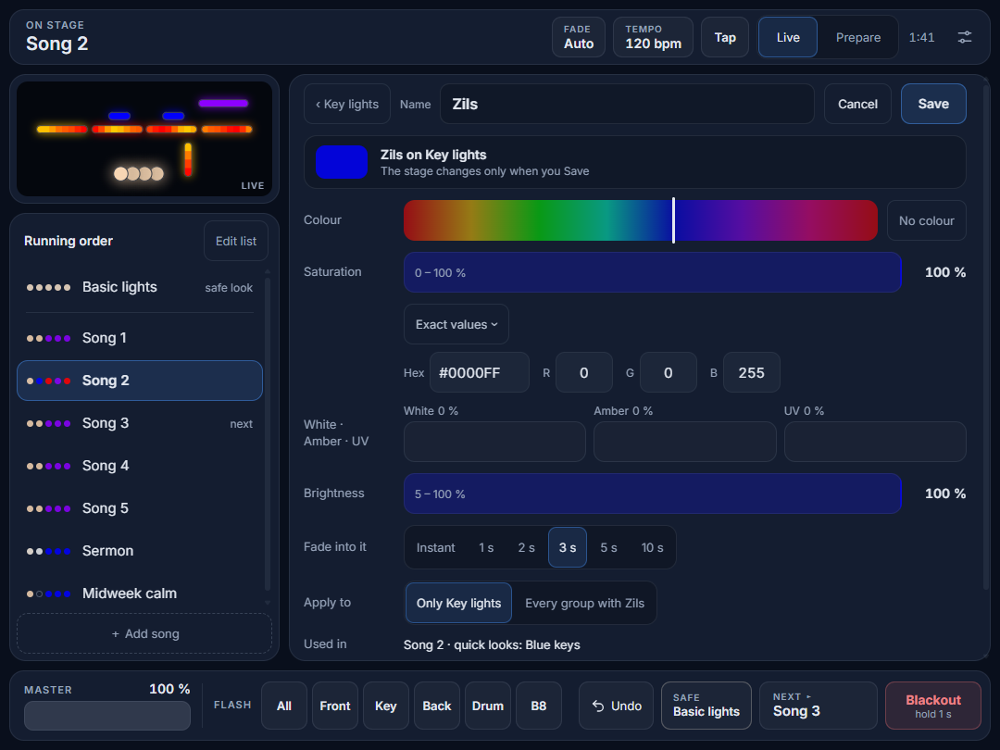</td>
  </tr>
  <tr>
    <td>The colour picker: tap to fade to a colour, hold to edit it.</td>
    <td>The colour editor, with Exact values open.</td>
  </tr>
  <tr>
    <td>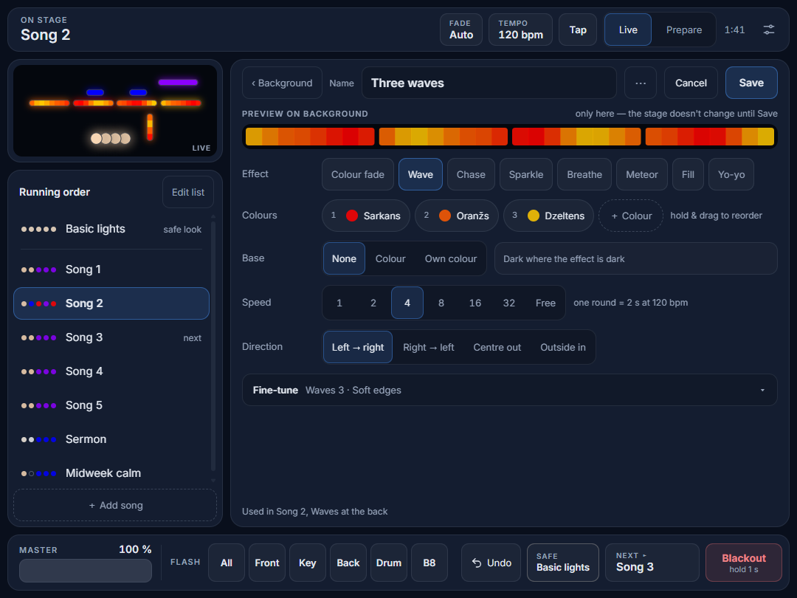</td>
    <td>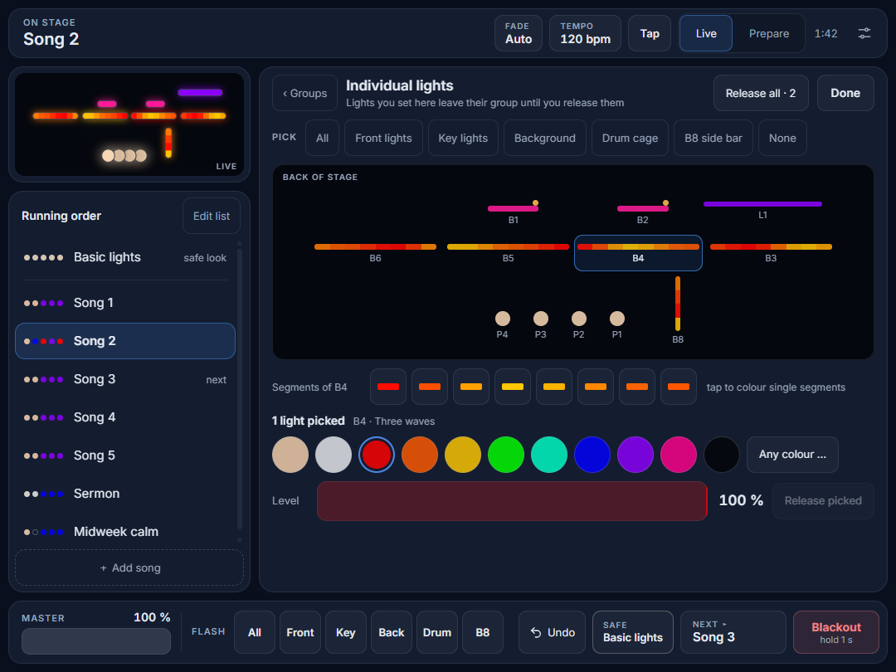</td>
  </tr>
  <tr>
    <td>The effect editor, with the effect moving in the strip.</td>
    <td>Individual lights: set one light, or one segment of a bar.</td>
  </tr>
</table>

### Individual lights

When Settings lets operators use manual control, **Individual lights** in the Groups panel opens a plan of the stage with a button for every light. Pick lights (or a whole group), give them a colour or a level, and they leave their group until you release them; they then fade back. With one bar picked you can colour its segments one by one. Basic lights, Blackout and Back to saved release them all.

### The phone remote

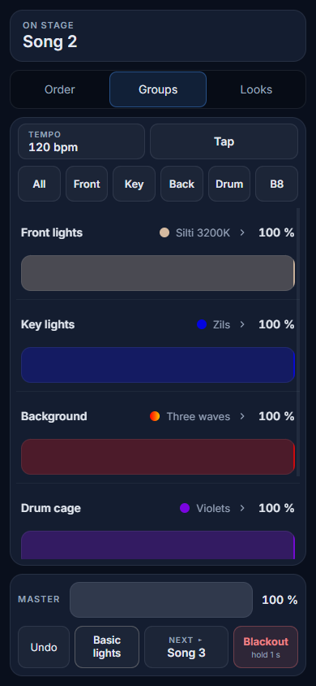

On a phone, the same page becomes a remote: the running order, each group's colour and level, quick looks, Master, Undo, Basic lights, Next and Blackout. It is for running the service from the floor; saving, editing and Prepare stay on the iPad.

Every page shows the same live state, so a change on the phone shows up on the iPad at once, and the other way round.

<br clear="right">

### Settings

Settings (`/settings/`) is for whoever sets the system up. It has:

- **DMX output:** Art-Net, sACN or an ENTTEC DMX USB Pro, a node finder, and a separate output for any universe that needs one. **Send DMX** hands the lights over to another desk and back.
- **Who to call:** a name and a phone number, shown to the volunteers when something is wrong with the lights.
- **Controller keys:** what each key, fader and knob on a MIDI controller does (see below).
- Whether operators may use manual control, OSC, the fixture database, the programmer PIN, backups, exporting the show and **Compare with a file**.

<table>
  <tr>
    <td width="50%">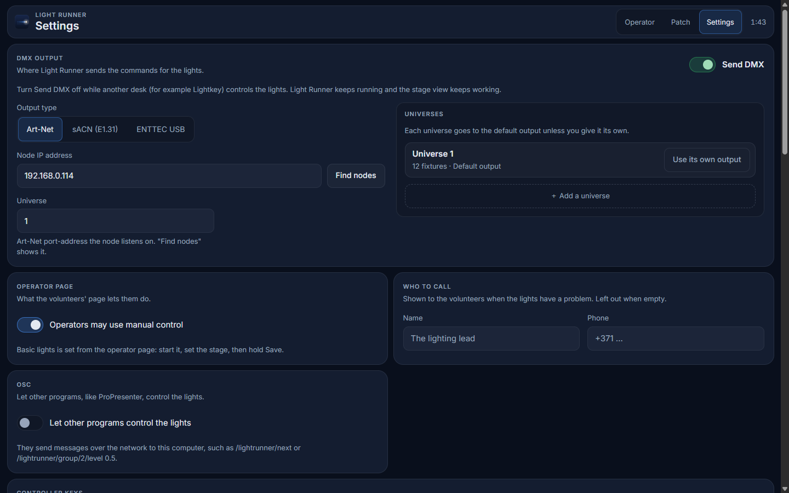</td>
    <td width="50%">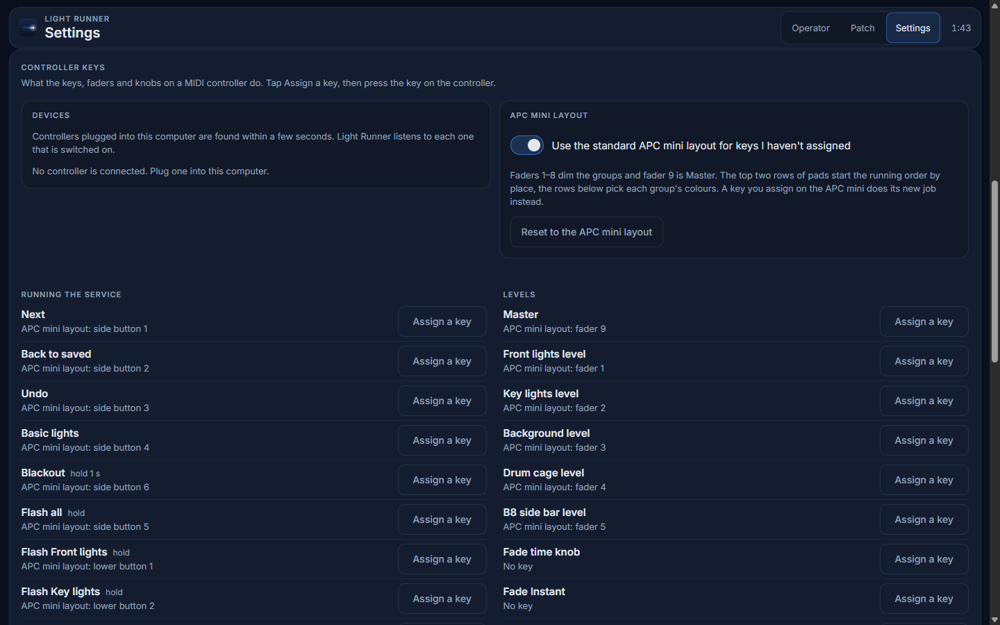</td>
  </tr>
</table>

### Patch

Patch (`/patch/`) is where the rig is set up, much like in Lightkey. The **DMX map** shows each universe's channels: drag a fixture to re-address it, drag a fixture type from the library onto free channels, and overlaps show at once in red. There is also a fixture table, groups, and Identify to flash a fixture so you can find it. Fixture types come from the [Open Fixture Library](https://open-fixture-library.org) (about 650 fixtures; download it once to use it without internet) or from a Lightkey project.

The **stage plan** says where each light hangs, and the operator page draws the stage from it. Each light gets a shape: a dot, a beam (a cone you aim), a bar (any length, thickness and angle), an outline (a strip round something) or a smoke cloud. Select several to align them or space them evenly.

<table>
  <tr>
    <td width="50%">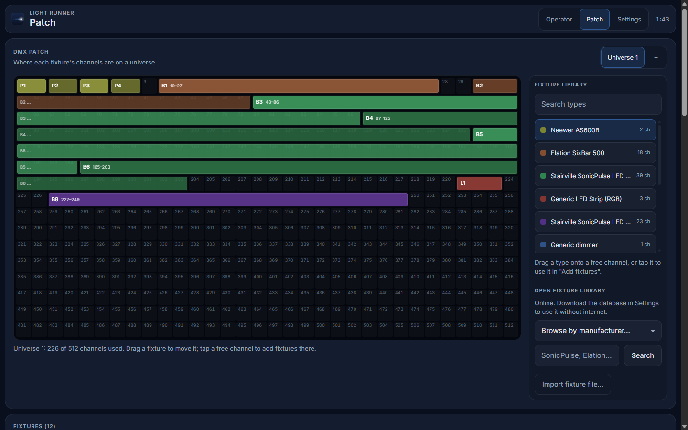</td>
    <td width="50%">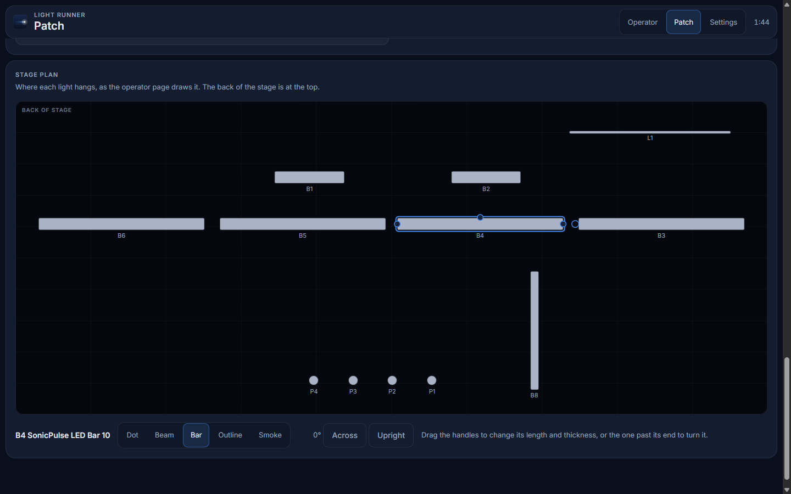</td>
  </tr>
</table>

## Remote control

Everything goes through the same server, so every device and every page always agree on what is on stage. [docs/companion.md](docs/companion.md) has the details and what to check on real hardware.

- **Stream Deck through Bitfocus Companion.** Use Companion's own Generic HTTP connection; no plugin needed. Buttons send simple requests such as `POST /api/next`, `POST /api/item/3` (the third item in the running order) or `POST /api/group/2/colour/4`, and `GET /api/companion` tells the buttons what is on stage, what is next and each group's colour and level.
- **OSC** from ProPresenter, TouchOSC or a script: addresses under `/lightrunner`, such as `/lightrunner/next`. Off until you switch it on in Settings (port 8000).
- **Akai APC mini.** Plug it in and it works with the standard layout: faders for the group levels and Master, the top pads for the running order, the pads below for each group's colours, and buttons for Flash, Next, Back to saved, Undo, Basic lights and Blackout (hold). Faders pick up, so a light never jumps. The mk2 shows the real colours on its pads.
- **Controller keys on any MIDI controller.** Give any key, fader or knob a job by tapping **Assign a key** and pressing it; nobody types MIDI numbers. A key you assign wins over the APC mini's standard layout. Operators can give songs (in running-order Edit) and quick looks their keys on the iPad; the other keys, Reset and the switches are in Settings, behind the programmer PIN when one is set.

Devices and controller keys always act on the real stage, never on an iPad's Prepare. None of this has met the real hardware yet; see [docs/STATUS.md](docs/STATUS.md).

## Reliability and light safety

- **Fades never jump.** Every change fades smoothly, including a new tap in the middle of a fade. An automated check runs hours of random changes and fails if any light ever steps more than 5 % between frames.
- **No more than 3 flashes a second.** Effects are slowed by themselves when a tempo would make any light flash faster.
- **Saves are safe.** A save never leaves a half-written show behind, and the last 20 are kept as backups (Settings > Backups).
- **It keeps going.** DMX runs on its own thread with a steady 40 frames a second and is restarted if it ever crashes. After a restart the stage comes back exactly as it was, and tablets reconnect by themselves.

## Running from source

This is for developers and for testing changes. To just use Light Runner, see Install above.

You need [Node.js](https://nodejs.org) 24 or newer. On the church Mac, Node 24 is Homebrew's `node@24`: use `/opt/homebrew/opt/node@24/bin/node` (or put `/opt/homebrew/opt/node@24/bin` on the PATH).

```bash
git clone https://github.com/ilmars/LightRunner.git
cd LightRunner
npm install
LIGHT_RUNNER_OUTPUT=none npm start   # away from the rig: never sends DMX
```

Open http://localhost:8080/. The first start loads a small demo rig. At the venue, leave out `LIGHT_RUNNER_OUTPUT=none` and run `npm start`.

| Page | Who | What |
| --- | --- | --- |
| `/operator/` | Volunteers (no login) | The iPad page, and the phone remote on a phone |
| `/patch/` | Programmer (PIN) | DMX map, fixture library, groups, stage plan |
| `/settings/` | Programmer (PIN) | Outputs, Send DMX, Who to call, controller keys, backups and more |

Patch and Settings ask for the programmer PIN once one is set (Settings > Programmer PIN). On the iPad, open `/operator/`, add it to the home screen (it has its own icon), and set Auto-Lock to Never so the screen stays on during the service. The Inter font and the icon are served by Light Runner itself, so the pages work with no internet.

| Setting | Default | What |
| --- | --- | --- |
| `PORT` | `8080` | Web port |
| `LIGHT_RUNNER_DATA` | `./data` | The live show, the last state, the backups and the fixture database |
| `LIGHT_RUNNER_OUTPUT` | — | `none` never sends DMX, whatever the show says |
| `LIGHT_RUNNER_FAKE_MIDI` | — | **For testing only:** `1` runs with a simulated APC mini mk2 and nanoKONTROL2 |

`data/` is not in git. To keep a show in the repository, export it (Settings > Export show file) into `shows/`. Run from source, Light Runner doesn't start itself when the computer starts; the installed app does.

### Bringing in a Lightkey project

In the app: Settings > **Compare with a file**, and choose the `.lightkeyproj`. You see what is new or changed, tick what to take, and only that is taken.

From the command line, to build a whole show from a project (needs Python 3):

```bash
python3 tools/import-lightkey.py "My Stage.lightkeyproj" shows/my-show.json \
  --artnet-host 192.168.0.114 --universe 1 \
  --group "Front lights=p1,p2,p3,p4" --group "Background=b3,b4,b5,b6"
node tools/install-show.ts shows/my-show.json   # stop the server first
```

Groups are named by the fixtures' short names in Lightkey; fixtures you don't list get a group per model.

Lightkey and Light Runner must not send to the same node at once. Switch **Send DMX** off in Settings while Lightkey runs the lights, and on again to take them back.

## Development

```bash
npm test             # unit and server tests
npm run typecheck
npm run jump-check   # hours of random changes; no light may step more than 5 % per frame
npm run timing-probe # DMX frame timing on this computer
```

TypeScript runs directly in Node (no build step); the pages are plain HTML and JavaScript.

| Folder | What |
| --- | --- |
| `packages/shared` | Show format, commands and live state, fixture types, Open Fixture Library converter, show compare and merge |
| `packages/engine` | The lighting engine: fades, groups, effects, manual, undo, channel mapping. No timers or I/O, so tests and tools run it directly |
| `server` | Web server and API, WebSocket, DMX worker thread and outputs, controllers, saving, fixture database |
| `web` | Operator, Patch and Settings pages, and the shared look in `web/shared` |
| `tools` | Lightkey importer, show installer, jump check, timing probe |
| `shows` | Show files |

More detail:

- [docs/SPEC.md](docs/SPEC.md): the product spec
- [docs/STATUS.md](docs/STATUS.md): what's built, what's next, known issues
- [docs/DECISIONS.md](docs/DECISIONS.md): choices made and why
- [docs/running-a-service.md](docs/running-a-service.md): setting up and running the lights for a service
- [docs/companion.md](docs/companion.md): Stream Deck, APC mini, controller keys and OSC
- [docs/design-system.md](docs/design-system.md): the pages' colours, type and brightness rules
- [CLAUDE.md](CLAUDE.md): project briefing (also read by Claude Code)

## Contributing

Ideas, bug reports and pull requests are welcome. [CONTRIBUTING.md](CONTRIBUTING.md) explains how to set up, what to check before sending a change, and how to test safely: Light Runner drives real lights, so changes should never surprise a volunteer on Sunday.

## License

MIT; see [LICENSE](LICENSE). Copyright (c) 2026 Light Runner contributors.

Fixture definitions come from the [Open Fixture Library](https://github.com/OpenLightingProject/open-fixture-library), which is also MIT-licensed; two of its fixture files are included as test data in `packages/shared/test/ofl/`, with OFL's license alongside them.
